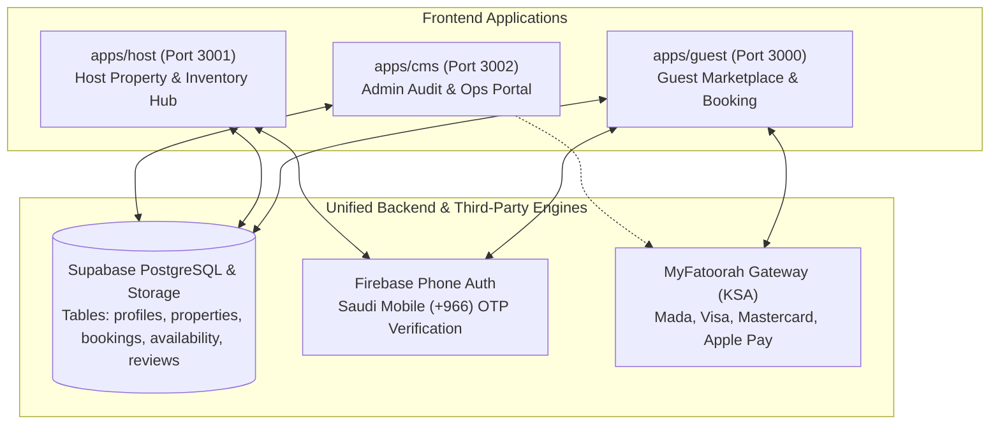
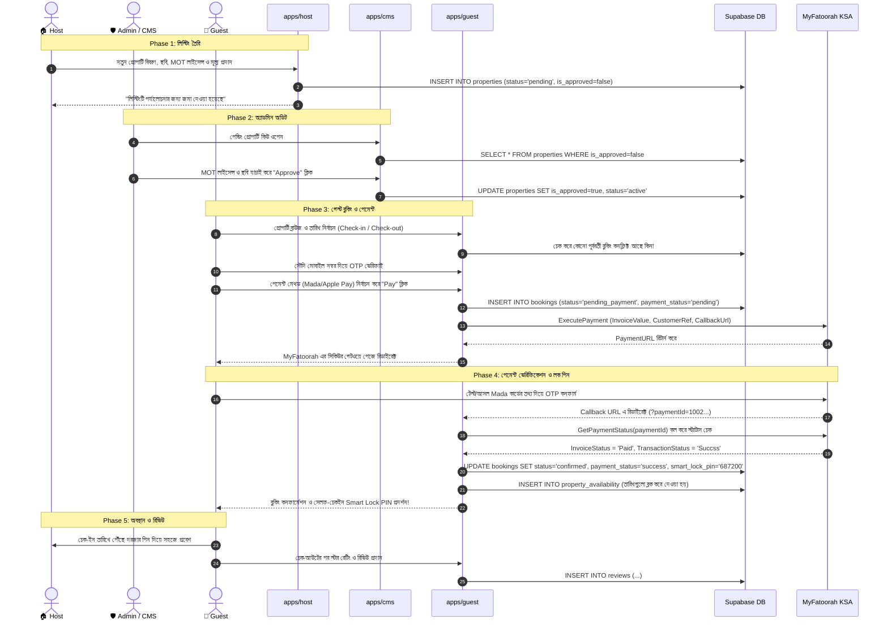

# QafNest Platform Workflow, Role Synchronization & Launch Guide
> **Document Status:** Active Production Architecture & Operational Manual  
> **Target Market:** Saudi Arabia (KSA) — Licensed Vacation Rentals, Chalets, Villas & Luxury Getaways  
> **Architecture:** Next.js 14 Monorepo (`apps/guest`, `apps/host`, `apps/cms`) + Supabase DB + MyFatoorah Gateway + Firebase Phone Auth

---

## ১. প্ল্যাটফর্মের সার্বিক আর্কিটেকচার (Architecture Overview)

QafNest একটি আধুনিক মনোরিপো-ভিত্তিক ইকোসিস্টেম। এখানে তিনটি প্রধান অ্যাপ একই সেন্ট্রাল ডেটাবেস ও অথেনটিকেশন সার্ভিসের সাথে সংযুক্ত:

| অ্যাপ | পোর্ট | টার্গেট ইউজার | মূল দায়িত্ব |
| :--- | :--- | :--- | :--- |
| **`apps/guest`** | `3000` | **Guest (গেস্ট/ভ্রমণকারী)** | প্রোপার্টি সার্চ, ফিল্টার, ফটো গ্যালারি, বুকিং ক্যালেন্ডার, ফোন ভেরিফিকেশন, MyFatoorah পেমেন্ট, স্মার্ট লক পিন ও রিভিউ। |
| **`apps/host`** | `3001` | **Host (মালিক/হোস্ট)** | নতুন প্রোপার্টি লিস্টিং তৈরি, MOT (Ministry of Tourism) লাইসেন্স প্রদান, নাইটলি/উইকেন্ড প্রাইসিং, ক্যালেন্ডার ব্লক, বুকিং ও উপার্জন মনিটরিং। |
| **`apps/cms`** | `3002` | **Admin / Moderator (অ্যাডমিন)** | প্রোপার্টি অডিট (MOT ও ছবি যাচাই), অনুমোদন (Approve) বা রিজেক্ট (Reject), রিভিউ মডারেশন, প্ল্যাটফর্ম রেভিনিউ পর্যবেক্ষণ। |

---

## ২. ইউজার রোল এবং তাদের কর্মপদ্ধতি (User Roles & Responsibilities)

### ১. Guest (المستأجر / ضيف)
- **উদ্দেশ্য:** রিয়াদ, জেদ্দা, আল-উলা, আবহা ইত্যাদিতে ভিলা, রিসোর্ট বা শاليه বুক করা।
- **কার্যক্রম:**
  1. প্ল্যাটফর্মে প্রবেশ করে লোকেশন, চেক-ইন/আউট তারিখ, অতিথি সংখ্যা ও ক্যাটাগরি ফিল্টার করা।
  2. প্রোপার্টির হাই-রেজোলিউশন ছবি, সুযোগ-সুবিধা, হাউজ রুলস ও পর্যটন মন্ত্রণালয় (MOT) ব্যাজ যাচাই করা।
  3. সৌদি মোবাইল নম্বর (+966) দিয়ে ১-ক্লিক SMS OTP ভেরিফিকেশন সম্পন্ন করা।
  4. Mada, Apple Pay বা ক্রেডিট কার্ডের মাধ্যমে MyFatoorah গেটওয়ে দিয়ে সুরক্ষিত পেমেন্ট সম্পন্ন করা।
  5. পেমেন্ট নিশ্চিত হলে স্বয়ংক্রিয়ভাবে **স্মার্ট ডিজিটাল ডোর লক পিন (Smart Lock PIN)** ও বুকিং রেফারেন্স পাওয়া।
  6. চেক-আউটের পর অভিজ্ঞতা শেয়ার করে রেটিং ও রিভিউ প্রদান করা।

### ২. Host (المضيف / المالك)
- **উদ্দেশ্য:** নিজের ভিলা বা শاليه লিস্ট করে আয় উপার্জন করা।
- **কার্যক্রম:**
  1. হোস্ট পোর্টালে মোবাইল নম্বর দিয়ে লগইন করা।
  2. নতুন লিস্টিং তৈরি করা: নাম (আরবি ও ইংরেজি), বিবরণ, জেলা/শহর, গুগল ম্যাপ লোকেশন, ধারণক্ষমতা, রুম সংখ্যা, অ্যামেনিটিস।
  3. উচ্চমানের ছবি আপলোড করা।
  4. সৌদি আইন অনুযায়ী **Ministry of Tourism (MOT) লাইসেন্স বা পারমিট নম্বর** প্রদান করা।
  5. বেস প্রাইস, উইকডে ও উইকেন্ডের রেট নির্ধারণ করা এবং প্রয়োজনমতো নির্দিষ্ট তারিখ ব্লক করা।
  6. লিস্টিংটি অ্যাডমিন পর্যালোচনার (Review) জন্য জমা দেওয়া।
  7. অনুমোদন পাওয়ার পর লাইভ ক্যালেন্ডারে বুকিং, অতিথির নাম, চেক-ইন তারিখ এবং নিজস্ব আয় ট্র্যাক করা।

### ৩. Admin / Operations Moderator (الإدارة / المشرف)
- **উদ্দেশ্য:** প্ল্যাটফর্মের গুণমান, আইনগত বৈধতা ও নিরাপত্তা নিশ্চিত করা।
- **কার্যক্রম:**
  1. অ্যাডমিন CMS পোর্টালে রোল-বেসড অথেনটিকেশন দিয়ে প্রবেশ করা।
  2. "Pending Approvals" কিউ থেকে হোস্টের জমা দেওয়া লিস্টিংগুলো পরীক্ষা করা।
  3. প্রোপার্টির ছবির গুণমান এবং MOT লাইসেন্স যাচাই করা।
  4. সন্তোষজনক হলে **Approve** করা (যা তাৎক্ষণিকভাবে গেস্ট অ্যাপের সার্চ ও ক্যাটালগে লাইভ হয়ে যায়)। কোনো ত্রুটি থাকলে ফিডব্যাকসহ **Reject** বা সংশোধন চাওয়া।
  5. গেস্টদের জমা দেওয়া রিভিউ পর্যবেক্ষণ করা এবং কোনো অযৌক্তিক রিভিউ থাকলে হোস্টের রিপ্লাই মডারেট করা।
  6. সামগ্রিক বুকিং ভলিউম এবং প্ল্যাটফর্ম ট্রানজ্যাকশন তদারকি করা।

---

## ৩. সম্পূর্ণ এন্ড-টু-এন্ড লাইফসাইকেল ফ্লো (End-to-End Workflow)

নিচের সিকোয়েন্স ডায়াগ্রামে হোস্ট লিস্টিং তৈরি থেকে শুরু করে অ্যাডমিন অ্যাপ্রুভাল, গেস্ট পেমেন্ট ও সেলফ-চেকইন পর্যন্ত প্রতিটি ধাপ দেখানো হলো:

---

## ৪. ডেটাবেস সিঙ্ক্রোনাইজেশন ম্যাট্রিক্স (Database Synchronization)

সবগুলো অ্যাপ একই সুসংগঠিত স্কিমার ওপর কাজ করে:

| টেবিলের নাম | রাইট এক্সেস (কারা লেখে) | রিড এক্সেস (কারা পড়ে) | সিঙ্ক্রোনাইজেশন লজিক |
| :--- | :--- | :--- | :--- |
| **`properties`** | Host (ড্রাফট/নতুন), Admin (অ্যাপ্রুভাল স্ট্যাটাস) | Guest (শুধুমাত্র `is_approved=true`), Host (নিজস্ব প্রোপার্টি), Admin (সব) | হোস্ট সাবমিট করলে `is_approved=false` থাকে; অ্যাডমিন অ্যাপ্রুভ করলেই স্বয়ংক্রিয়ভাবে গেস্টদের সার্চ ইঞ্জিনে আসে। |
| **`property_availability`**| Host (ম্যানুয়াল ব্লক/প্রাইস ওভাররাইড), সিস্টেম (বুকিং কনফার্মেশনের পর) | Guest (তারিখ এভেইলেবল কিনা দেখতে), Host (ক্যালেন্ডার ভিউ) | গেস্ট বুকিং পেইড হলেই তারিখগুলো স্বয়ংক্রিয়ভাবে লক হয়ে যায় যাতে ডাবল বুকিং অসম্ভব হয়। |
| **`bookings`** | Guest (চেকআউট ও পেমেন্ট), সিস্টেম (MyFatoorah ভেরিফিকেশন) | Guest (নিজের বুকিং), Host (তার প্রোপার্টির বুকিং), Admin | পেমেন্ট সফল না হওয়া পর্যন্ত `status='pending_payment'`; MyFatoorah কলব্যাকে ভেরিফাই হলেই কেবল `status='confirmed'` ও লক পিন ইস্যু হয়। |
| **`profiles`** | Guest / Host (মোবাইল OTP লগইনের সময়) | ব্যবহারকারী নিজে ও অ্যাডমিন | ব্যবহারকারীর ফোন, পূর্ণ নাম, রোল (`guest` / `host` / `admin`) সংরক্ষিত থাকে। |
| **`reviews`** | Guest (চেক-আউট সম্পন্ন হওয়া সাপেক্ষে), Host (রিপ্লাই) | সাধারণ পাবলিক (গেস্ট ক্যাটালগ) | শুধুমাত্র প্রকৃত সম্পন্ন বুকিংধারী গেস্টই রিভিউ দিতে পারে। |

---

## ৫. প্ল্যাটফর্ম লাইভ করার প্রাক-পরীক্ষা চেকলিস্ট (Pre-Launch Testing Checklist)

অ্যাপটি প্রোডাকশনে লাইভ করার পূর্বে নিচের ধাপগুলো ক্রমানুসারে সম্পন্ন ও যাচাই করতে হবে:

### ধাপ ১: এনভায়রনমেন্ট কনফিগারেশন যাচাই
- [ ] Supabase প্রোডাকশন URL ও Anon Key উভয় অ্যাপে সেট করা।
- [ ] Firebase Console এ Saudi Arabia (+966) SMS Region Policy সক্রিয় আছে কিনা পরীক্ষা করা।
- [ ] Firebase Authorized Domains এ প্রোডাকশন ডোমেন (যেমন: `qafnest.com`, `business.qafnest.com`) যুক্ত করা।
- [ ] MyFatoorah লাইভ অ্যাকাউন্টের ক্ষেত্রে:
  - `MYFATOORAH_IS_TEST=false`
  - `MYFATOORAH_BASE_URL=https://api.myfatoorah.com/v2` (অথবা KSA পোর্টালের জন্য `https://api-sa.myfatoorah.com/v2`)
  - লাইভ প্রোডাকশন `MYFATOORAH_API_KEY` সেট করা।

### ধাপ ২: রোল ও ডেটা ফ্লো টেস্ট
- [ ] **হোস্ট ফ্লো:** `apps/host` থেকে একটি নতুন প্রোপার্টি সাবমিট করুন। যাচাই করুন সেটি ডেটাবেসে `is_approved: false` অবস্থায় জমা হয়েছে।
- [ ] **অ্যাডমিন ফ্লো:** `apps/cms` এ গিয়ে প্রোপার্টিটি অনুমোদন (Approve) করুন।
- [ ] **গেস্ট ব্রাউজিং:** `apps/guest` এ সার্চ দিয়ে দেখুন অনুমোদিত প্রোপার্টিটি সার্চ রেজাল্টে দেখা যাচ্ছে।
- [ ] **বুকিং ও পেমেন্ট টেস্ট:**
  - গেস্ট হিসেবে সৌদি ফোন নম্বর দিয়ে OTP ভেরিফাই করুন।
  - চেকআউটে কার্ড সিলেক্ট করে পে চাপুন।
  - নিশ্চিত করুন যে MyFatoorah গেটওয়েতে রিডাইরেক্ট হচ্ছে (কোনো বাইপাস ছাড়াই)।
  - Mada টেস্ট কার্ড (`4464 0400 0000 0007`) দিয়ে পেমেন্ট সফল করুন।
  - রিডাইরেক্ট হয়ে কনফার্মেশন স্ক্রিন এবং ৬-সংখ্যার সেলফ-চেকইন লক পিন দেখতে পাচ্ছেন কিনা যাচাই করুন।
- [ ] **ডাবল বুকিং প্রতিরোধ টেস্ট:** একই তারিখে আবার ওই প্রোপার্টি বুক করার চেষ্টা করুন; সিস্টেম "These dates are unavailable" এরর দেবে।

### ধাপ ৩: Vercel ডিপ্লয়মেন্ট আর্কিটেকচার
মনোরিপোটি Vercel-এ ৩টি আলাদা প্রজেক্ট হিসেবে হোস্ট করার সুপারিশ করা হলো:
1. **Guest App:** Root Directory = `apps/guest` → ডোমেন: `qafnest.com`
2. **Host App:** Root Directory = `apps/host` → ডোমেন: `business.qafnest.com` (বা `host.qafnest.com`)
3. **CMS / Ops App:** Root Directory = `apps/cms` → ডোমেন: `admin.qafnest.com`

---

## ৬. সংক্ষেপে সারসংক্ষেপ

1. **কোন ব্যবহারকারী কী করে?**
   - হোস্ট প্রোপার্টি লিস্টিং বানায় ও দাম নির্ধারণ করে।
   - অ্যাডমিন সেটি আইনগতভাবে ও গুণগতভাবে অ্যাপ্রুভ করে।
   - গেস্ট প্রোপার্টি খুঁজে নিয়ে সৌদি নম্বরে OTP দিয়ে MyFatoorah এর মাধ্যমে টাকা পরিশোধ করে।
2. **কখন কী সিঙ্ক হয়?**
   - অ্যাডমিন অ্যাপ্রুভ করলেই গেস্ট অ্যাপে আসে।
   - গেস্টের পেমেন্ট MyFatoorah তে ভেরিফাই হলেই বুকিং কনফার্ম হয় এবং স্মার্ট লক পিন উৎপন্ন হয়।
   - পেমেন্ট সম্পন্ন হলেই ক্যালেন্ডার ব্লক হয়, যা হোস্ট তার ড্যাশবোর্ডে সাথে সাথে দেখতে পায়।
3. **কোনো বাইপাস নেই:** প্ল্যাটফর্মে কোনো অবস্থাতেই আনপেইড বুকিং কনফার্ম হবে না। প্রতিটি পেমেন্ট সরকারি পেমেন্ট হাব MyFatoorah দ্বারা ক্রিপ্টোগ্রাফিক্যালি ভেরিফাইড।

