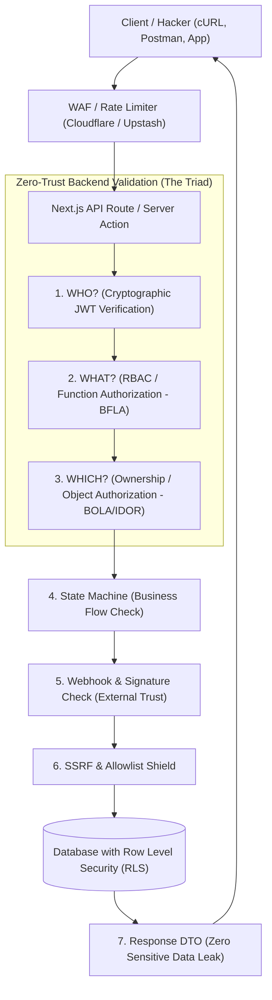

# QAFNEST · BACKEND & API SECURITY MASTER PLAN
> **Source Analysis**: "Every API Security Mistakes Explained..." (@sharif_nasrullah · AI Learners BD)  
> **Standard**: OWASP API Security Top 10 (Enterprise Production Edition)  
> **Scope**: QafNest Monorepo — Guest (`:3000`), Host (`:3001`), CMS Super Admin (`:3002`), Database & Server Actions.  
> **Status**: Living Architectural Standard (বাধ্যতামূলক নিরাপত্তা নির্দেশিকা)

---

## ১. ভূমিকা ও মূল বার্তা (Executive Summary)

ভিডিওটির প্রধান সতর্কতা:
> **"ফ্রন্টএন্ড সাজাতে ডেভেলপাররা যতটা সময় দেয়, ব্যাকএন্ড API সিকিউরিটিতে ততটাই ফাঁক রেখে দেয়। একজন হ্যাকার ব্রাউজারের কোনো বাটনে ক্লিক না করে সরাসরি স্ক্রিপ্ট বা API টুলের মাধ্যমে ৩০ সেকেন্ডের মধ্যে পুরো ডাটাবেস মুছে ফেলতে পারে কিংবা $0 পেমেন্টে সিস্টেম থেকে আনলিমিটেড বুকিং/রিওয়ার্ড নিয়ে নিতে পারে।"**

আমাদের **QafNest** প্ল্যাটফর্ম একটি হাই-ভ্যালু ফিনান্সিয়াল ও হসপিটালিটি সিস্টেম (যেখানে বুকিং পেমেন্ট, স্মার্ট লক পিন, হোস্টের ব্যাংক পে-আউট, আইবিএএন এবং পর্যটন মন্ত্রণালয়ের লাইসেন্সকৃত ডেটা সংরক্ষিত থাকে)। তাই এই ১০টি সিকিউরিটি পিলার আমাদের প্রতিটি ফিচার ডেভেলপমেন্টের জন্য **বাধ্যতামূলক চেকলিস্ট** হিসেবে গণ্য হবে।



---

## ২. ভিডিওতে বর্ণিত ১০টি বিপদ ও কিউএএফনেস্ট ইমপ্লিমেন্টেশন প্ল্যান

---

### পিলার ১: Never Trust the Frontend (ফ্রন্টএন্ডের ওপর শূন্য বিশ্বাস)
* **ঝুঁকি**: UI-তে অ্যাডমিন বাটন বা ড্রপডাউন লুকিয়ে রাখা (`isAdmin && <DeleteButton />`) মানেই সিস্টেম নিরাপদ নয়। অ্যাটাকার ব্রাউজার ডেভটুলস বা নেটওয়ার্ক ট্যাব দেখে সরাসরি এন্ডপয়েন্টে `POST /api/admin/...` কল করতে পারে।
* **কিউএএফনেস্ট স্ট্যান্ডার্ড**:
  1. ক্লায়েন্ট-সাইড পারমিশন কেবল **ইউজার এক্সপেরিয়েন্স (UX)** এর জন্য; এটি কোনো নিরাপত্তা বলয় নয়।
  2. প্রতিটি সার্ভার অ্যাকশন এবং API রুটের ভেতরে সেশনের ভ্যালিডেশন এবং রোল রিকোয়ারমেন্ট পুনরায় চেক করতে হবে।
  ```typescript
  // ❌ ভুল পদ্ধতি (শুধুমাত্র ক্লায়েন্টের পাঠানো প্যারামিটার বিশ্বাস করা)
  export async function POST(req: Request) {
    const { isAdmin, propertyId } = await req.json();
    if (isAdmin) { await deleteProperty(propertyId); }
  }

  // ✅ সঠিক পদ্ধতি (সার্ভার সাইড সেশন ও টোকেন থেকে রোল যাচাই)
  export async function POST(req: Request) {
    const session = await getAuthenticatedUser(req);
    if (!session || session.role !== 'SUPER_ADMIN') {
      return NextResponse.json({ error: 'Forbidden' }, { status: 403 });
    }
    await deleteProperty(propertyId);
  }
  ```

---

### পিলার ২: Broken Access Control (BOLA, BFLA & IDOR প্রতিরোধ)
* **ঝুঁকি**:
  * **BFLA (Broken Function Level Authorization)**: সাধারণ ইউজার হোস্ট বা অ্যাডমিনের API কল করে ফেলা।
  * **BOLA / IDOR (Broken Object Level Authorization)**: ইউজার অন্যের `booking_id` বা `property_id` প্যারামিটারে পাঠিয়ে অন্যের রিজার্ভেশন বা পেমেন্ট স্টেটমেন্ট দেখে ফেলা।
* **ভিডিওর সমাধান ফর্মুলা**: ব্যাকএন্ডে প্রতি রিকোয়েস্টে ৩টি প্রশ্ন যাচাই করতে হবে:
  * **WHO?**: রিকোয়েস্টকারী আসলে কে? (ক্রিপ্টোগ্রাফিক ভেরিফাইড ইউজার আইডি)
  * **WHAT?**: সে কি অ্যাকশন নিতে চাচ্ছে? (View, Edit, Delete, Cancel)
  * **WHICH?**: সে কোন নির্দিষ্ট রেকর্ডের ওপর অ্যাকশন নিচ্ছে? রেকর্ডটি কি তারই মালিকানাধীন?
* **কিউএএফনেস্ট স্ট্যান্ডার্ড**:
  1. ডাটাবেজ কোয়েরিতে সবসময় মালিকানা ফিল্টার থাকতে হবে:
     `SELECT * FROM bookings WHERE id = :bookingId AND guest_id = :authenticatedUserId`
  2. Supabase-এ সকল টেবিলে **Row Level Security (RLS)** বাধ্যতামূলক সক্রিয় রাখা।
  3. ইউজার ইনপুটের `userId` কখনো সরাসরি কোয়েরিতে ব্যবহার না করে টোকেন থেকে এক্সট্র্যাক্ট করা `auth.uid()` ব্যবহার করা।

---

### পিলার ৩: Business Logic Abuse (বিজনেস ফ্লো হাইজ্যাক প্রতিরোধ)
* **ঝুঁকি**: অ্যাটাকার অ্যাপের স্বাভাবিক স্টেপ বাইপাস করে সরাসরি পরবর্তী স্টেপের API কল করে। যেমন: পেমেন্ট গেটওয়ে স্কিপ করে সরাসরি `/api/bookings/confirm` বা রিওয়ার্ড ক্লেইম করা।
* **কিউএএফনেস্ট স্ট্যান্ডার্ড**:
  1. **সার্ভার সাইড স্টেট মেশিন (Finite State Machine)**:
     $$\text{DRAFT} \longrightarrow \text{PENDING\_PAYMENT} \longrightarrow \text{PAID\_CONFIRMED} \longrightarrow \text{COMPLETED}$$
  2. কোনো রিজার্ভেশন স্ট্যাটাস `PAID_CONFIRMED` হতে পারবে না যতক্ষণ না পেমেন্ট প্রোভাইডার থেকে সাকসেস স্টেটাস সার্ভার-সাইডে কনফার্মড হয়।
  3. **Idempotency Keys**: ডাবল বুকিং বা বারবার চার্জ হওয়া রোধে প্রতিটি ট্রানজেকশনে ইউনিক আইডেমপোটেন্সি কি নিশ্চিত করা।

---

### পিলার ৪: Trusting External APIs (থার্ড-পার্টি সার্ভিস অন্ধ বিশ্বাস রোধ)
* **ঝুঁকি**: পেমেন্ট গেটওয়ে (Moyasar, HyperPay, Tabby, Tamara) বা এসএমএস গেটওয়ে থেকে আসা ওয়েবহুকে শুধু বডি দেখে বিশ্বাস করা। অ্যাটাকার নিজেই ফেক ওয়েবহুক রিকোয়েস্ট বানিয়ে পেমেন্ট স্ট্যাটাস `true` পাঠাতে পারে।
* **কিউএএফনেস্ট স্ট্যান্ডার্ড**:
  1. **HMAC Signature Verification**: প্রতিটি ওয়েবহুকে `X-Signature` বা `X-Webhook-Secret` হেডার যাচাই করতে হবে।
  2. **সার্ভার-টু-সার্ভার ডাবল ভেরিফিকেশন (Out-of-band Verification)**: উচ্চমূল্যের ট্রানজেকশনের ক্ষেত্রে গেটওয়ের API-তে সরাসরি সার্ভার থেকে `GET /v1/payments/{id}` কল করে নিশ্চিত হতে হবে যে ট্রানজেকশনটি সত্যি সফল এবং টাকার পরিমাণ হুবহু মিলছে।

---

### পিলার ৫: SSRF (Server-Side Request Forgery প্রতিরোধ)
* **ঝুঁকি**: সার্ভার যখন ইউজারের দেওয়া URL ফেচ করে (যেমন প্রপার্টি ইমেজ আপলোড ফ্রম URL, ইনভয়েস ডাউনলোড বা সাইট প্রিভিউ), তখন হ্যাকার ইন্টারনাল নেটওয়ার্ক বা ক্লাউড মেটাডেটা আইপি পাঠায়:
  `http://169.254.169.254/latest/meta-data/` বা `http://localhost:5432`
  এর মাধ্যমে ক্লাউড প্রোভাইডারের রুট ক্রেডেনশিয়াল বা ডাটাবেজ এক্সেস ফাঁস হয়ে যায়।
* **কিউএএফনেস্ট স্ট্যান্ডার্ড**:
  1. **Domain Allowlist**: শুধুমাত্র অনুমোদিত ডোমেইন থেকে রিমোট অ্যাসেট ফেচ করা যাবে (যেমন: `*.supabase.co`, `images.unsplash.com`)।
  2. **Private IP Blocking**: রিকোয়েস্ট পাঠানোর পূর্বে DNS রেজোলিউশন করে Private IP (`10.0.0.0/8`, `172.16.0.0/12`, `192.168.0.0/16`, `127.0.0.1`, `169.254.0.0/16`) কঠোরভাবে ব্লক করা।

---

### পিলার ৬: Sensitive Data Exposure (গোপন ডেটা লিকেজ রোধ)
* **ঝুঁকি**: API রেসপন্সে পুরো অবজেক্ট রিটার্ন করা (যেমন: হোস্টের ব্যক্তিগত ফোন নম্বর, পে-আউট IBAN, ন্যাশনাল আইডি বা পাসওয়ার্ড হ্যাশ) এবং ফ্রন্টএন্ডে তা হাইড করা।
* **কিউএএফনেস্ট স্ট্যান্ডার্ড**:
  1. **Data Transfer Objects (DTO)**: ডাটাবেজ থেকে ডেটা নিয়ে সরাসরি রিটার্ন না করে শুধুমাত্র পাবলিকলি অনুমোদিত ফিল্ডের অবজেক্ট তৈরি করে রিটার্ন করা।
  2. কোয়েরিতে কখনো উন্মুক্ত `select('*')` ব্যবহার না করা; শুধুমাত্র নির্দিষ্ট প্রয়োজনীয় কলাম নির্বাচন করা।

---

### পিলার ৭: Strict Input Validation & Sanitization (ইনপুট যাচাই)
* **ঝুঁকি**: ইনপুট টাইপ, ফরম্যাট বা লেন্থ চেক না করায় SQL Injection, NoSQL Injection, Prototype Pollution বা ক্রস-সাইট স্ক্রিপ্টিং (XSS) হওয়া।
* **কিউএএফনেস্ট স্ট্যান্ডার্ড**:
  1. প্রতিটি API রিকোয়েস্টের শুরুতে **Zod Schema** দিয়ে রিকোয়েস্ট বডি পার্স ও স্যানিটাইজ করা।
  2. অপ্রত্যাশিত বা অতিরিক্ত ফিল্ড স্বয়ংক্রিয়ভাবে স্ট্রিপ (Strip) করে বাদ দেওয়া।
  3. এসকিউএল কোয়েরিতে সর্বদা প্যারামিটারাইজড কুয়েরি ব্যবহার করা (ORMs/Supabase Client স্বয়ংক্রিয়ভাবে এটি হ্যান্ডেল করে)।

---

### পিলার ৮: Rate Limiting & Resource Protection (রেট লিমিটিং)
* **ঝুঁকি**: ওটিপি (OTP) সেন্ডিং, লগইন অ্যাটেম্পট বা পেমেন্ট চেকআউট এন্ডপয়েন্টে আনলিমিটেড রিকোয়েস্ট পাঠিয়ে এসএমএস কস্ট বাড়ানো বা ব্রুট-ফোর্স অ্যাটাক চালানো।
* **কিউএএফনেস্ট স্ট্যান্ডার্ড**:
  1. **OTP Endpoints**: প্রতি ফোন নম্বরে সর্বোচ্চ ৩টি ওটিপি রিকোয়েস্ট প্রতি ১০ মিনিটে।
  2. **Auth Endpoints**: প্রতি আইপিতে সর্বোচ্চ ৫টি ফেইলড লগইন ট্রাই প্রতি ১৫ মিনিটে।
  3. **Checkout Endpoints**: টোকেন বাকেট অ্যালগরিদম ভিত্তিক রেট লিমিটিং।

---

### পিলার ৯: API Inventory & Zombie Route Management (এপিআই ইনভেন্টরি)
* **ঝুঁকি**: পুরানো v1 রুট, টেস্ট রুট বা ডেভেলপমেন্ট ডিব্যাগ রুট (`/api/test-db`, `/api/mock-checkout`) প্রোডাকশনে চালু থাকা।
* **কিউএএফনেস্ট স্ট্যান্ডার্ড**:
  1. প্রতিটি রিলিজের আগে সমস্ত ডেব ও মক রুট বিল্ড থেকে বাদ দেওয়া।
  2. স্ট্রিক্ট রুট ভার্শনিং মেনে চলা (`/api/v1/...`)।

---

### পিলার ১০: Security Misconfiguration & Secrets Management (কনফিগারেশন নিরাপত্তা)
* **ঝুঁকি**: ব্রাউজার ক্লায়েন্টে সার্ভিস রোল কি পাঠানো, `NEXT_PUBLIC_` প্রিফিক্স দিয়ে প্রাইভেট সিক্রেট এক্সপোজ করা, এবং ওয়াইল্ডকার্ড `Access-Control-Allow-Origin: *` রাখা।
* **কিউএএফনেস্ট স্ট্যান্ডার্ড**:
  1. `SUPABASE_SERVICE_ROLE_KEY` বা কোনো প্রাইভেট কি কখনো ক্লায়েন্ট ফাইলে ব্যবহার না করা।
  2. নিরাপদ CORS পলিসি ও সিকিউরিটি হেডারস (Content-Security-Policy, Strict-Transport-Security, X-Frame-Options) নিশ্চিত করা।
  3. প্রোডাকশনে কোনো ডাটাবেজ এরর স্ট্যাকট্রেস ক্লায়েন্টে না পাঠিয়ে জেনেরিক এরর কোড প্রদান করা।

---

## ৩. কিউএএফনেস্ট অ্যাকশন প্ল্যান (Implementation Roadmap)

| ফেজ | সিকিউরিটি টাস্ক | কভার্ড পিলার্স | টার্গেট ফাইলসমূহ |
| :--- | :--- | :--- | :--- |
| **ফেজ ১** | **JWT ক্রিপ্টোগ্রাফিক ভেরিফিকেশন** (শুধু ডিকোড না করে ক্রিপ্টোগ্রাফিক সিগনেচার ভেরিফাই করা) | পিলার ১, পিলার ৪ | `apps/guest/src/app/api/payments/checkout/route.ts` |
| **ফেজ ২** | **BOLA & BFLA গার্ড** (বুকিং, রিভিউ ও পে-আউট রুটে WHO-WHAT-WHICH রুল প্রয়োগ) | পিলার ২, পিলার ৬ | `apps/guest/src/app/api/reviews/*`, `apps/host/src/app/api/*` |
| **ফেজ ৩** | **পেমেন্ট স্টেট মেশিন ও আইডেমপোটেন্সি** (পেমেন্ট ভেরিফিকেশন ছাড়া কনফার্মেশন ব্লক) | পিলার ৩, পিলার ৪ | `apps/guest/src/app/api/payments/*` |
| **ফেজ ৪** | **Zod স্কিমা ভ্যালিডেশন লেয়ার** (সকল API বডির জন্য কঠোর টাইপ চেকিং) | পিলার ৭ | `apps/*/src/app/api/**` |
| **ফেজ ৫** | **SSRF ফিল্টার ও প্রাইভেট আইপি ব্লকার** (রিমোট ইমেজ/URL ফেচিং এর জন্য) | পিলার ৫ | `packages/security/ssrf.ts` বা `apps/*/src/lib/security` |
| **ফেজ ৬** | **রেট লিমিটিং মিডলওয়্যার** (OTP, লগইন এবং বুকিং এন্ডপয়েন্টে) | পিলার ৮ | `middleware.ts` |

---

> [!IMPORTANT]
> **কমিটমেন্ট**: এর পর থেকে QafNest-এর প্রতিটি নতুন রুট, ফিচার বা ডাটাবেজ ইন্টিগ্রেশনের সময় এই **১০টি সিকিউরিটি পিলার** কঠোরভাবে যাচাই করে বাস্তবায়ন করা হবে।
