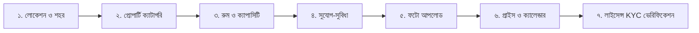
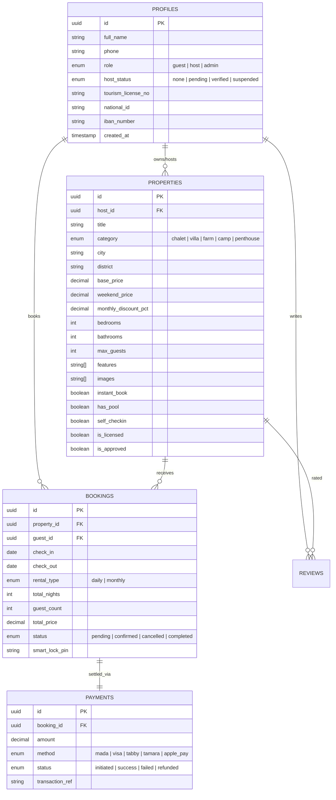

# 🦅 QAFNEST: কমপ্লিট ইউনিফায়েড মাস্টার প্ল্যান ও আর্কিটেকচার রোডম্যাপ
> **Gathern.co (جاذر إن) ফাংশনাল বেঞ্চমার্ক + QafNest লাক্সারি ডিজাইন + Supabase ফুল-স্ট্যাক ব্যাকএন্ড**

---

## ১. নির্বাহী সারসংক্ষেপ ও গ্যাথার্ন (Gathern.co) বেঞ্চমার্ক

সৌদি আরবের শীর্ষস্থানীয় ভ্যাকেশন রেন্টাল প্ল্যাটফর্ম **Gathern.co** (সৌদি পর্যটন মন্ত্রণালয় কর্তৃক লাইসেন্সপ্রাপ্ত)-এর সমস্ত অপশন, ফিচার ও নেভিগেশনাল প্যাটার্নকে আমাদের **QafNest**-এর প্রিমিয়াম ও লাক্সারি থিমের সাথে নিখুঁতভাবে সমন্বয় করে এই মাস্টার প্ল্যানটি প্রস্তুত করা হয়েছে।

### মূল দর্শন:
- **ফাংশনালিটি ও প্যাটার্ন:** ১০০% Gathern.co এর মতো সম্পূর্ণ (Daily/Monthly Rent, Multi-Search Bar, Granular Filters, Host Verification, Tabby/Tamara Split, Smart Lock)।
- **ডিজাইন ও ইউজার এক্সপেরিয়েন্স:** QafNest-এর সিগনেচার নিয়ন-গ্লো, ফ্রস্টেড গ্লাস মরফিজম এবং ডার্ক/লাইট মোড কমপ্লায়েন্ট।
- **ব্যাকএন্ড ইঞ্জিন:** Supabase (Auth, PostgreSQL DB, Storage, RLS) + Next.js 14 App Router।

---

## ২. নেভিগেশন বার আর্কিটেকচার (Gathern 1:1 Functional Mapping)

Gathern-এর মেনুবারের প্রতিটি অপশন আমাদের নেভিগেশন বারে যেভাবে সমন্বিত হয়েছে:

```
┌────────────────────────────────────────────────────────────────────────────────────────┐
│ [Logo: QAF NEST]   [Stay Types ∨] [Destinations ∨] [Flash Deals 🔥] [Host Portal ∨]   │
│                                           [🔍 Search] [☀️/🌙 Theme] [🌐 EN/SAR ∨] [👤 Profile / Sign In] [Book a Stay ↗] │
└────────────────────────────────────────────────────────────────────────────────────────┘
```

### ২.১ মেনুবার আইটেমসমূহ:
1. **ব্র্যান্ড লোগো (Brand Identity):**
   - ড্যাশড অরবিট/রাডার গ্লিফ + `QAF` (বোল্ড) `NEST` (পার্পল গ্রেডিয়েন্ট) + Ministry License Badge।
2. **প্রোপার্টি ক্যাটাগরি মেনু (Property Categories ∨):**
   - **Private Chalets & Resorts (شاليهات ومنتجعات):** ব্যক্তিগত সুইমিং পুল ও গার্ডেন সহ।
   - **Luxury Private Villas (فلل خاصة فاخرة):** ফ্যামিলি ও গেট-টুগেদার ভিলা।
   - **Heritage & Organic Farms (مزارع واستراحات):** প্রাকৃতিক ও গ্রামীণ অবকাশ কেন্দ্র।
   - **Desert Glamping & Camps (مخيمات وقباب العلا):** মরুভূমির তাঁবু ও কারাফান।
   - **Serviced VIP Penthouses (بنتهاوس وشقق مخدومة):** শহরের প্রাইম লোকেশনের প্রিমিয়াম অ্যাপার্টমেন্ট।
3. **ডেস্টিনেশন মেনু (Destinations ∨):**
   - রিয়াদ (Al-Ammariyah, Diriyah), জেদ্দা (Obhur Waterfront), আল-উলা (Desert Stargazing), আল-খোবার (Eastern Corniche), আবহা (Asir Highlands), তায়েফ।
4. **ইজারার ধরন (Rental Duration Mode):**
   - **Daily Rent (إيجار يومي):** সাপ্তাহিক ছুটি ও স্বল্পমেয়াদি অবকাশ যাপনের জন্য।
   - **Monthly Rent (إيجار شهري):** দীর্ঘমেয়াদি স্টে (৩৫% পর্যন্ত সেভিংস সহ)।
5. **হোস্ট পোর্টাল (Gathern Business / Host with Us ∨):**
   - "List Your Property (سجل عقارك)"
   - "Host Earnings Calculator (حاسبة أرباح المضيف)"
   - "1,000,000 SAR Host Protection Guarantee"
6. **টুলস ও একাউন্ট সেকশন (Right Utility Controls):**
   - 🔍 **ইন্টারেক্টিভ সার্চ আইকন:** ক্লিক করলেই পূর্ণাঙ্গ সার্চ ও ফিল্টার উইন্ডো ওপেন হওয়া।
   - 🌙/☀️ **ডার্ক ও লাইট থিম সুইচ:** লোকালস্টোরেজে পারসিস্টেন্ট থিম সেভ।
   - 🌐 **গ্লোব ড্রপডাউন:** ভাষা নির্বাচন (English / العربية) এবং কারেন্সি (SAR ﷼, USD $, AED د.إ, EUR €)।
   - 👤 **ইউজার স্টেট / প্রোফাইল:**
     - লগইন না থাকলে: `Sign In / Register` মোডাল।
     - লগইন থাকলে: অবতার, নাম, রোল ব্যাজ (`Guest` / `Host`), বুকিংস হিস্ট্রি এবং ১-ক্লিকে `Sign Out` বাটন।
   - 🚀 **প্রাইমারি CTA:** `Book a Stay ↗` (সরাসরি ফিল্টার ও সার্চ উইন্ডো অ্যাক্টিভেশন)।

---

## ৩. মাল্টি-সেগমেন্টেড সিগনেচার সার্চ বার (Gathern Search Pattern)

Gathern-এর মূল সার্চ সিস্টেমটি ৪টি প্রধান সেগমেন্টে বিভক্ত, যা আমাদের হোমপেজ হিরো এবং সার্চ মোডালে হুবহু থাকবে:

```
┌─────────────────┬───────────────────┬───────────────────┬──────────────────────┐
│ 📍 Where?       │ 📅 Dates          │ 👥 Who?           │ ⚡ Rent Type & Search │
│ City / District │ Check-in ➔ Out    │ Adults & Children │ [Daily/Monthly] [ 🔍]│
└─────────────────┴───────────────────┴───────────────────┴──────────────────────┘
```

1. **সেগমেন্ট ১: কোথায় যেতে চান? (Where / Destination):**
   - সৌদি আরবের প্রধান ১৮০+ শহর ও লোকালিটির ড্রপডাউন ও অটো-কমপ্লিট ইনপুট।
2. **সেগমেন্ট ২: চেক-ইন ও চেক-আউট (Calendar Date-Range):**
   - ইন্টারেক্টিভ ডুয়েল ক্যালেন্ডার (বুক করা বা ব্লকড ডেট স্বয়ংক্রিয়ভাবে ডিসেবল থাকবে)।
3. **সেগমেন্ট ৩: অতিথি সংখ্যা ও মজলিস ক্যাপাসিটি (Guests & Capacity):**
   - প্রাপ্তবয়স্ক (Adults), শিশু (Children) এবং পারিবারিক মজলিস বা ইভেন্ট ক্যাপাসিটি সিলেক্টর।
4. **সেগমেন্ট ৪: রেন্ট টাইপ টগল এবং সার্চ ট্রিগার:**
   - ডেইলি রেন্ট বনাম মান্থলি রেন্ট সুইচ এবং সার্চ এক্সিকিউশন বাটন।

---

## ৪. গ্র্যানুলার ফিল্টারিং সিস্টেম (Granular Filter Engine)

Gathern-এর সমস্ত অ্যাডভান্সড ফিল্টার আমাদের সিস্টেমে অন্তর্ভুক্ত:

| ফিল্টার ক্যাটাগরি | ফিল্টার অপশনসমূহ |
| :--- | :--- |
| **মূল্য পরিসীমা (Price Range)** | SAR ১০০ থেকে SAR ১৫,০০০+ (মিনিমাম-ম্যাক্সিমাম স্লাইডার ও ইনপুট বক্স) |
| **লাইসেন্স ও ভেরিফিকেশন** | পর্যটন মন্ত্রণালয় অনুমোদিত ভেরিফায়েড লাইসেন্স (`Ministry of Tourism Licensed`) |
| **বুকিং টাইপ** | তাৎক্ষণিক বুকিং (`Instant Book` - হোস্টের অনুমোদনের অপেক্ষায় না থেকে সরাসরি কনফার্মেশন) |
| **সুযোগ-সুবিধা (Amenities)** | • ব্যক্তিগত সুইমিং পুল (ইনডোর/আউটডোর/হিটেড পুল)<br>• প্রাইভেট জ্যাকিউজি (Jacuzzi / Hot Tub)<br>• আউটডোর সিটিং ও বারবিকিউ এরিয়া (جلسة خارجية وشواء)<br>• স্মার্ট লক সেলফ চেক-ইন (Keyless Smart Lock PIN)<br>• ফ্রি হাই-স্পিড ওয়াই-ফাই ও স্মার্ট টিভি<br>• পুরুষ ও মহিলাদের পৃথক মজলিস<br>• বাচ্চাদের খেলার জায়গা (Kids Playground) |
| **পেমেন্ট ফ্লেক্সিবিলিটি** | ৪ কিস্তিতে পরিশোধের সুবিধা (`Tabby / Tamara` ৪ মাসের সহজ কিস্তি) |
| **বাতিলকরণ নীতি** | বিনামূল্যে বাতিলকরণ (`Free Cancellation` ২৪-৪৮ ঘণ্টা আগে) |

---

## ৫. প্রোপার্টি ডিটেইলস পেজ ও বুকিং চেকআউট ইঞ্জিন

Gathern-এর বুকিং ফ্লো অনুসারে প্রতিটি প্রোপার্টির জন্য ডাইনামিক পেজ (`/properties/[id]`):

### ৫.১ পেজের উপাদানসমূহ:
- **হাই-রেজ্যুলেশন ফটো গ্যালারি:** ফুল-স্ক্রিন লাইটবক্স ভিউয়ার এবং ৩৬০° ভার্চুয়াল ট্যুর সাপোর্ট।
- **হোস্ট পরিচিতি ও লাইসেন্স ব্যাজ:** হোস্টের রেসপন্স রেট, সুপারহোস্ট ব্যাজ এবং মন্ত্রণালয় লাইসেন্স নং (CR / Tourism License No.)।
- **স্বচ্ছ মূল্য বিভাজন (Transparent Pricing Breakdown):**
  - মূল ভাড়া (Base Rate × রাতের সংখ্যা)
  - ক্লিনিং ফি (Cleaning Fee)
  - ১৫% সৌদি ভ্যাট (15% VAT)
  - সর্বমোট প্রদেয় মূল্য (Total SAR)
  - Tabby / Tamara প্রতি মাসের কিস্তির হিসাব (যেমন: `﷼৪৬২ / মাস`)
- **স্মার্ট লক ও স্বয়ংক্রিয় এক্সেস:** বুকিং কনফার্ম হওয়ার পর অতিথির WhatsApp ও SMS-এ চেক-ইনের ডিজিটাল পিন কোড পৌঁছানো।
- **গেস্ট রিভিউ ও স্কোরবোর্ড:** পরিচ্ছন্নতা (Cleanliness), লোকেশন (Location), হোস্ট কমিউনিকেশন (Host Communication) এবং ভ্যালু ফর মানি (Value) অনুযায়ী আলাদা রেটিং।

---

## ৬. হোস্ট অনবোর্ডিং ও গ্যাথার্ন বিজনেস পোর্টাল (Gathern Business Flow)

হোস্টদের জন্য সম্পূর্ণ ৭-ধাপের অনবোর্ডিং ও প্রোপার্টি লিস্টিং সিস্টেম:



1. **ধাপ ১: লোকেশন ও ঠিকানা:** গুগল ম্যাপ পিন, শহর, জেলা ও ল্যান্ডমার্ক।
2. **ধাপ ২: প্রোপার্টির ধরণ:** শ্যালে, ভিলা, ফার্ম, ক্যাম্প, অথবা পেন্টহাউস।
3. **ধাপ ৩: স্পেসিফিকেশন:** বেডরুম সংখ্যা, বাথরুম, বেড সাইজ এবং সর্বোচ্চ অতিথি ধারণক্ষমতা।
4. **ধাপ ৪: সুযোগ-সুবিধা টিকলিস্ট:** সুইমিং পুলের সাইজ, জ্যাকিউজি, কিচেন, মজলিস, স্মার্ট লক ইত্যাদি।
5. **ধাপ ৫: ছবি আপলোড:** ড্র্যাগ-অ্যান্ড-ড্রপ মাল্টিপল ফটো আপলোড (Supabase Storage Bucket)।
6. **ধাপ ৬: ক্যালেন্ডার ও প্রাইসিং:** সাধারণ দিনের ভাড়া, উইকেন্ড (বৃহস্পতি-শুক্রবার) ভাড়া এবং ব্লকড ডেটস।
7. **ধাপ ৭: হোস্ট কেওয়াইসি ও পর্যটন লাইসেন্স:** জাতীয় পরিচয়পত্র (Iqama/National ID), সৌদি পর্যটন মন্ত্রণালয় লাইসেন্স নং এবং পে-আউটের জন্য সৌদি IBAN ব্যাংক অ্যাকাউন্ট।

---

## ৭. সুসংহত Supabase ডাটাবেস আর্কিটেকচার (Unified Schema)



---

## ৮. বাস্তবায়ন রোডম্যাপ (Implementation Phases)

### 🔹 ধাপ ১: লোকাল ভেরিফিকেশন ও সার্চ সিস্টেম (সম্পন্ন ✅)
- নেভিগেশন বার রিডিজাইন (Gathern + রেফারেন্স স্টাইল অনুযায়ী ফুল-উইডথ)।
- ডার্ক ও লাইট থিমের সম্পূর্ণ ফাংশনালিটি ও লোকালস্টোরেজ পারসিস্টেন্স।
- ইন্টারেক্টিভ ও ফ্লেক্সিবল সার্চ মোডাল (`SearchModal.tsx`) চালু—ডেইলি/মান্থলি রেন্ট, সিটি ও ক্যাটাগরি ফিল্টার এবং লাইভ সার্চ রেজাল্ট সহ।
- লোকাল ডেভেলপমেন্ট সার্ভার সক্রিয় (`http://localhost:3000`)।

### 🔹 ধাপ ২: প্রোপার্টি ডিটেইলস ডাইনামিক পেজ (`/properties/[id]`)
- Gathern স্টাইলের ফটো গ্যালারি ভিউয়ার।
- ক্যালেন্ডার ডেট-পিকার সহ লাইভ প্রাইস ক্যালকুলেটর (ট্যাক্স + Tabby ৪ কিস্তির হিসাব)।
- হোস্ট ইনফো ও লাইসেন্স ব্যাজ ডিসপ্লে।

### 🔹 ধাপ ৩: হোস্ট পোর্টাল ও প্রোপার্টি লিস্টিং উইজার্ড (Gathern Business)
- ৭-স্টেপ প্রোপার্টি সাবমিশন ফর্ম।
- ছবি আপলোড (Supabase Storage Bucket Integration)।
- হোস্ট ড্যাশবোর্ড (প্রোপার্টি এডিট, ক্যালেন্ডার ডেট লক/আনলক ও আয় হিসাব)।

### 🔹 ধাপ ৪: বুকিং চেকআউট ও পেমেন্ট ইন্টিগ্রেশন
- চেকআউট পেজ (Mada, Apple Pay, Tabby/Tamara)।
- বুকিং কনফার্মেশন ও ডিজিটাল স্মার্ট লক পিন অটো-জেনারেটর।
- গেস্ট ড্যাশবোর্ড (মাই বুকিংস, ইনভয়েস ও উইশলিস্ট)।

### 🔹 ধাপ ৫: সুপার অ্যাডমিন মডারেশন ও ফাইনাল প্রোডাকশন
- অ্যাডমিন প্যানেল: হোস্ট পর্যটন লাইসেন্স রিভিউ ও লিস্টিং অ্যাপ্রুভাল।
- ডিসপিউট ও প্ল্যাটফর্ম কমিশন ট্র্যাকিং।
- ইউজার রিভিউ ও টেস্টিংয়ের পর অনুমতিক্রমে GitHub পুশ ও Vercel লাইভ ডিপ্লয়মেন্ট।
